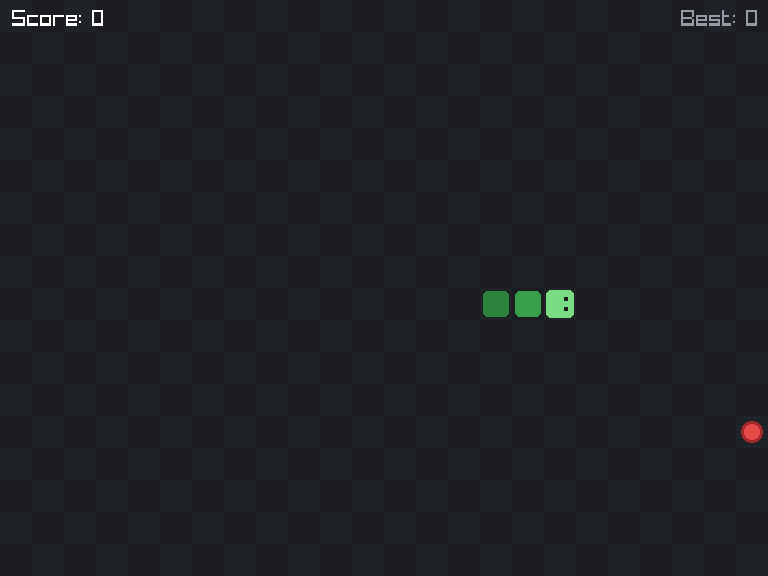

# Odin Snake

A tiny 2D Snake game written in [Odin](https://odin-lang.org/) using the
built-in `vendor:raylib` bindings. No third-party dependencies beyond the
compiler itself.



## Features

- 24x18 grid with a subtle checkerboard
- Snake that speeds up with every apple it eats
- Score and session-best display
- Wall and self collision, game-over screen with instant restart
- Headless logic self-test (`./snake selftest`)

## Controls

| Key             | Action            |
| --------------- | ----------------- |
| Arrow keys/WASD | Steer the snake   |
| R / Enter       | Restart after death |

You cannot reverse into your own neck; turns are buffered until the next
tick. Eat the red apple to grow - each one makes the snake a little faster.

## Download

Prebuilt binaries are attached to the
[latest release](https://github.com/appu3008/odin-snake/releases/latest),
built automatically by GitHub Actions:

| Platform                    | File                       |
| --------------------------- | -------------------------- |
| Windows 64-bit              | `snake-windows-amd64.zip`  |
| Linux 64-bit                | `snake-linux-amd64.tar.gz` |

### Windows

1. Grab `snake-windows-amd64.zip` from the releases page.
2. Extract it and double-click `snake.exe`.

### Linux

```sh
curl -L https://github.com/appu3008/odin-snake/releases/latest/download/snake-linux-amd64.tar.gz | tar xz
./snake
```

The Linux build links against the system X11 and OpenGL libraries
(`libx11`, `libgl`), which are present on most desktop distributions.

## Build from source

You need the [Odin compiler](https://odin-lang.org/) (dev-2026-11a or newer;
raylib is bundled with it) and a C linker.

```sh
git clone https://github.com/appu3008/odin-snake
cd odin-snake
odin build . -o:speed
./snake
```

### Linux build dependencies

```sh
sudo apt install libx11-dev libxi-dev libxrandr-dev libxinerama-dev \
     libxcursor-dev libgl1-mesa-dev
```

### Windows

Install Odin and [LLVM](https://releases.llvm.org/) (clang must be on your
`PATH`), then run `odin build . -o:speed`. The resulting `snake.exe` is
statically linked against the bundled raylib.

## Running the tests

```sh
./snake selftest
```

prints `SELFTEST PASS` when the game logic (movement, eating, collision,
turn buffering) behaves as expected.

## License

MIT - see [LICENSE](LICENSE). Uses raylib, bundled with the Odin compiler.
